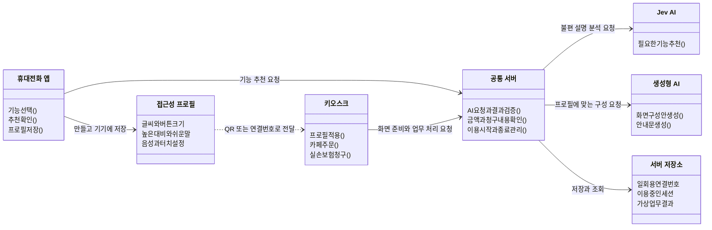

# 내 방식 QR — 수정 버전의 간단한 클래스 다이어그램

카페 주문과 실손보험 청구로 수정한 버전을 기준으로 작성했습니다. 실제 코드는 React 컴포넌트와 함수 모듈 중심이며, 아래 상자는 이해하기 쉽게 역할별로 묶어 표현했습니다. 세부 함수와 중간 통신 모듈은 생략했습니다.

1. **휴대전화 앱**에서 필요한 기능을 고르고 저장합니다. 불편한 점을 글이나 말로 입력하면 Jev가 기능을 추천하며, 사용자가 확인합니다.
2. **접근성 프로필**을 QR이나 일회용 연결번호로 전달하면 **키오스크**가 그 설정을 적용합니다. 카페 주문 화면과 병원 실손 청구 화면은 서로 다른 URL이며 공통 프로그램을 사용합니다.
3. **공통 서버**는 생성형 AI의 화면 구성안과 안내문을 검증해 키오스크에 돌려줍니다. 주문 금액과 청구 조건은 프로그램이 확인하고, 이용 중 화면 구성은 유지합니다.

프로필 원본은 휴대전화에 남습니다. 서버에는 연결번호용 프로필과 이용 세션·결과를 임시로 보관합니다. AI 오류 시 기본 화면을 사용하며, 결제와 보험사 전송은 가상 처리입니다.
