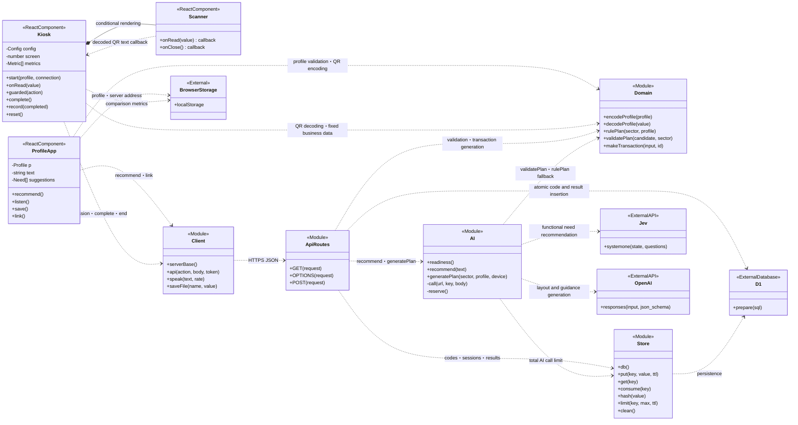
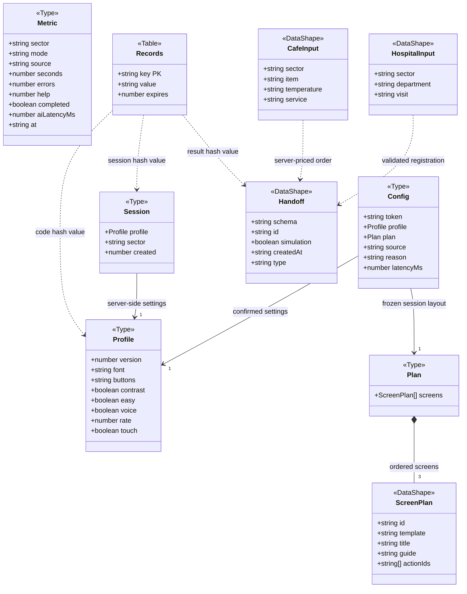
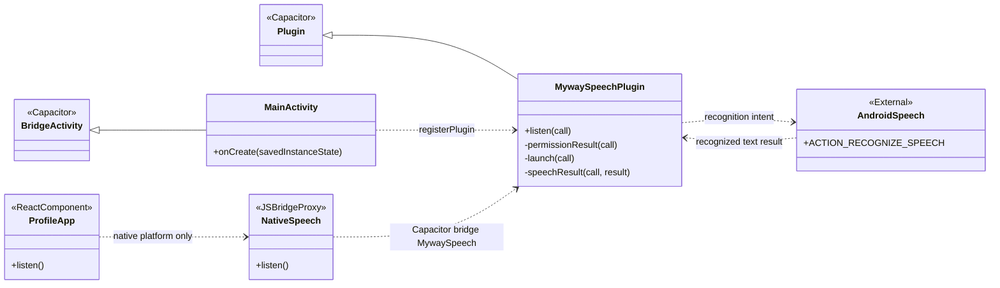

# 내 방식 QR — 구현 기준 클래스 다이어그램

> 이 문서는 키오스크 개선 전 버전의 구조 기록입니다. 실손 청구·다품목 주문으로 변경한 현재 구조는 [키오스크 개선 v2](kiosk-v2.md)를 참고하세요.

작성일: 2026-10-22. 현재 프로젝트 소스를 읽어 작성했다. 배포 사이트를 변경하지 않는 설명 문서다.

이 프로젝트는 React 함수 컴포넌트와 TypeScript 함수 모듈 중심이다. 아래 `ReactComponent`와 `Module`은 실제 클래스를 새로 도입했다는 뜻이 아니라, 각 컴포넌트와 파일의 책임을 클래스 표기법으로 묶어 표현한 것이다. `Type`은 실제 TypeScript 타입, `DataShape`는 익명 데이터 구조, `Table`은 DB 테이블이다. Java의 MainActivity·MywaySpeechPlugin과 로컬 개발 어댑터 Statement는 실제 클래스다.

## 1. 앱·키오스크·공통 서버

### 모듈별 실제 파일

| 다이어그램 요소 | 실제 파일 | 주요 역할 |
|---|---|---|
| ProfileApp | `components/ProfileApp.tsx` | 기능 선택·추천 확인·기기 저장·QR·연결번호 발급 |
| Kiosk | `components/Kiosk.tsx` | 병원·카페 화면, 조작, 완료, 초기화, 비교 기록 |
| Scanner | `components/Scanner.tsx` | 카메라 영상을 jsQR로 읽어 QR 문자열 반환 |
| Client | `lib/client.ts` | 공통 서버 통신, 음성 읽기, JSON 저장 |
| ApiRoutes | `app/api/[...path]/route.ts` | 입력 검증·추천·연결·세션·업무 처리 |
| AI | `lib/ai.ts` | Jev·OpenAI 호출, 호출 제한, 실패 시 대체 처리 |
| Domain | `lib/domain.ts` | 프로필·구성안 스키마, 고정 메뉴·허용 동작, 업무 데이터 생성 |
| Store | `lib/store.ts` | 만료 시간 포함 저장, 일회용 조회·삭제, 해시, 횟수 제한 |

## 2. 데이터 구조와 관계

- `Profile`에는 이름·장애명·진단명·예약정보가 없다. 글씨·버튼 크기, 대비, 쉬운 말, 음성·속도, 터치 보정만 들어간다.
- `ScreenPlan`은 `planScreenSchema`에서 추론되는 내부 구조를 설명용으로 이름 붙였다. `template`은 `grid`, `list`, `step`만 허용한다.
- `Config`는 키오스크가 보관하는 이용 설정이며, 서버의 `Session`과 다르다. 서버 `Session`에는 화면 구성안이나 원문 설명이 저장되지 않는다.
- `HospitalInput`, `CafeInput`, `Handoff`는 설명용 이름이다. 실제 구현에서는 `transactionSchema`의 분기와 `makeTransaction()`의 반환 객체로 표현한다. 병원 결과는 진료과·방문 유형·대기번호, 카페 결과는 품목·수량·단가·총액·이용 방법을 포함한다.
- `Records`는 `db/schema.ts`의 `records` 테이블이다. `value`는 문자열이며 프로필·세션·업무 결과는 JSON으로, 요청 횟수는 숫자 문자열로 저장한다. 키 접두어와 해시로 구분한다.
- 연결번호는 3분 후 만료되고 사용 시 원자적으로 삭제된다. 서버 세션은 15분 유효하며, 키오스크는 3분간 입력이 없으면 초기화를 시도한다. 화면 초기화 시 서버 세션·결과 삭제 요청도 보낸다. 이 요청이 실패하면 서버에서는 만료 시간으로 접근을 제한한다.
- `Metric`은 키오스크의 로컬 저장소에 최대 300건 유지한다. 프로필과 세션을 초기화해도 비교 기록은 남는다.

## 3. Android 음성 입력과 실제 클래스

`MainActivity.java`와 `MywaySpeechPlugin.java`는 `android/app/src/main/java/kr/myway/pass/`에 있다. `NativeSpeech`는 `ProfileApp.tsx`에서 `registerPlugin('MywaySpeech')`로 만든 JS 프록시다. Android 음성 서비스가 음성을 텍스트로 바꾸고, 사용자가 추천을 요청하면 그 텍스트를 공통 서버를 거쳐 Jev에 전달한다. Jev에 원본 오디오를 직접 보내는 구조는 아니다. 웹에서는 브라우저의 SpeechRecognition을 사용한다.

로컬 개발 전용 `lib/local-env.ts`에는 실제 `Statement` 클래스가 있다. `bind()`, `first()`, `run()`으로 Node SQLite를 D1과 비슷하게 사용할 수 있게 한다. 공개 배포에서는 이 어댑터 대신 Cloudflare D1을 사용한다.

## 4. 실제 실행 순서

1. **프로필 만들기:** 사용자가 기능을 직접 선택하거나 불편 설명을 입력한다. 음성은 먼저 텍스트로 변환된다. `ProfileApp → Client → ApiRoutes → AI → Jev` 순서로 추천을 받고, 사용자가 수정·확인한 기능만 프로필에 반영한다.
2. **저장·전달:** 프로필은 휴대전화 로컬 저장소에 저장한다. QR에는 프로필 자체를 인코딩한다. 대체 연결번호는 서버에 프로필을 잠시 저장하고 번호로 찾아오는 방식이다. QR 생성·해독 자체에는 서버가 필요 없지만 현재 키오스크의 세션 시작·AI 처리·업무 완료에는 서버가 필요하다.
3. **화면 준비:** 키오스크가 프로필과 기기 가로·세로 크기를 `/api/session`에 보낸다. AI 모드에서는 서버가 확정 프로필·기기 조건·원본 세 화면을 OpenAI에 전달한다. `validatePlan()`이 구조·화면 ID·필수 동작·제한 문구를 확인한다. 실패하면 `rulePlan()` 결과를 사용한다.
4. **업무 진행:** 키오스크는 검증된 구성안을 기존 React 화면 틀과 CSS로 표시한다. 글씨·버튼 크기, 대비, 터치 보정은 프로그램이 프로필에 따라 적용한다. 안내 읽기는 기기 음성 합성으로 처리한다. AI 구성안은 세션 시작 때 만들고 이용 중에는 유지한다.
5. **접수·주문 완료:** 사용자가 최종 버튼을 누르면 `/api/complete`가 세션과 업무 입력을 확인한다. 서버는 고정 메뉴의 가격으로 결과를 생성하고 중복 완료 요청에는 기존 결과를 돌려준다. 업무 ID는 세션 토큰과 별도로 만든다. 결과를 JSON으로 저장하거나 확인증을 인쇄할 수 있으며 실제 POS·병원 시스템 전송이나 결제는 구현 범위에 포함되지 않는다.
6. **종료·기록:** 완료시간·오류·도움 요청·AI 소요 시간을 로컬에 기록한다. 이용 종료 시 키오스크의 프로필·화면 설정·업무 결과를 초기화하고 서버 세션과 결과 삭제를 요청한다. 휴대전화의 원본 프로필은 다음 이용을 위해 유지한다.

## 5. 현재 검증 범위

이 문서는 실제 소스의 구조를 설명한다. AI 검증은 스키마·허용 동작·문구 제한 검사이며, 모든 기기에서 화면이 겹치지 않거나 모든 안내문이 충분히 쉽다는 것을 자동으로 증명하지는 않는다. 실제 휴대전화·태블릿의 카메라·음성·화면 배치 확인과 이용자 사용성 검증은 별도로 필요하다.
