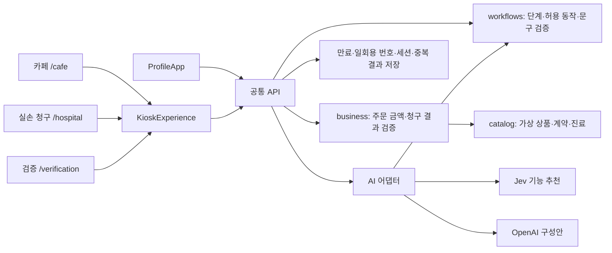

# 키오스크 개선 v2

## 범위

- `/cafe`: 메가커피 참고 사진의 노란 상단 탭·상품 그리드·하단 장바구니·옵션 및 결제 확인 구조를 반영한다. 브랜드는 가상 매장 모닝커피를 사용한다. 상품 그림은 자체 SVG이며 실제 메뉴 사진이나 공식 가격이 아니다.
- `/hospital`: 기존 원무 업무 확장안 대신 실손보험 청구에 집중한다. 가상 청구인 확인 → 가상 보험계약 → 진료 복수 선택 → 청구 사유 → 서류 → 동의·전송 → 완료의 일곱 단계다.
- `/verification`: 기본·규칙·AI 모드 비교, 검수 문구 비교, 익명 기록, 가상 결제 거절 검증과 업무 전달 JSON 확인.
- `/profile`: 기존 프로필 형식을 유지한다. 모델명과 홍보 문구를 제거하고 접근성 설정·저장·QR에 집중한다. 개발 연결 설정은 `/profile?settings=1`에서만 노출한다.

## 구현 구조

`Kiosk.tsx`는 `KioskExperience.tsx`를 다시 내보낸다. 화면 구성은 일곱 단계 전체에 대해 세션 시작 때 생성하고 이용 중 유지한다. AI 구성안은 단계 ID·동작 ID와 버튼 의미를 보존해야 한다. 버튼 문구는 미리 검수한 일반/쉬운 말 중 하나만 허용한다. 제목·안내문은 생성 후 구조와 금지 문구 검사를 거친다. 필수 동의·가상 처리 고지·금액·문서명은 생성 안내와 별도로 고정 표시한다.

`lib/catalog.ts`는 일곱 카테고리의 상품 28종과 허용 옵션, 단가, 가상 보험사·진료를 정의한다. `lib/business.ts`는 `myway.handoff.v2` 결과를 생성한다. 주문 원가는 상품·옵션·수량으로 서버가 다시 계산하며, 포인트는 가상 결제 합계의 1%다. 휴대전화 번호는 테스트 번호만 UI에서 허용하고 서버 요청·결과·검증 기록에 넣지 않는다.

카페 `/api/payment`가 가상 승인 여부를 처리하고 승인 결과를 원자적으로 보관한다. 거절 시 주문 완료 결과를 만들지 않으며 재시도할 수 있다. `/api/complete`는 실손 청구의 가상 환자·계약·진료·서류 확인·동의를 검사한다. 실제 결제·본인인증·보험사 전송·보험금 산정은 하지 않는다. 현재 서버는 최종 입력을 검증하며 사용자가 화면을 실제 어떤 순서로 열었는지까지 인증하는 상태 머신은 아니다.

키오스크는 3분 미사용 시 프로필·선택 내용·계좌 예시·결과를 초기화하고 서버 세션 삭제를 요청한다. 서버 세션은 최대 15분 유효하다. 익명 비교 기록은 별도로 브라우저에 유지한다. 검증 경로는 별도 인증이 없는 시연 도구이며 관리자 보안 경계가 아니다.

## Android

Capacitor 8 내장 `SystemBars`의 CSS 인셋 처리를 명시하고 주입되는 `--safe-area-inset-*`를 앱 외곽 여백에 사용한다. 웹에서는 표준 `env(safe-area-inset-*)`를 대체 값으로 사용한다. `viewport-fit=cover`를 유지하고 키보드 표시에는 `adjustResize`를 설정한다. 고정 높이의 상단 빈 공간을 추가하지 않는다. 실제 단말의 상태 표시줄·카메라·음성·키보드 검증은 별도다.

## 참고 자료와 가정

- UI: https://daramlee.tistory.com/5 — 사용자가 지정한 2024년 사진을 기준으로 하며 최신 공식 메가커피 UI의 재현이라고 주장하지 않는다.
- 청구 절차: https://www.fsc.go.kr/no040101?cnId=2920&curPage=1&pastPage=1&srchKey=sj&srchText=%EC%8B%A4%EC%86%9024
- 시스템 설명: https://www.silson24.or.kr/claim/web/system/systemIntro
- 병원 고정형 키오스크의 실손 청구 지원은 이 프로젝트의 가상 UX이며 공식 실손24 키오스크 연동 제품이 아니다. 실제 청구 절차의 보험계약·진료·서류 선택을 참고했으며 고정 병원이므로 병원 검색은 생략한다. 대리·미성년자·입원 청구는 이 버전에 포함하지 않는다.

## 검증

- `node --test tests/domain.test.ts tests/workflows.test.ts tests/ai-failure.test.mjs`: 프로필 호환·서버 가격·잘못된 옵션·청구 동의·AI 검증과 실패 대체.
- `node tests/kiosk-integration.mjs`: 경로·랜딩 제거·연결번호·결제 거절/재시도/중복·개인정보·청구·세션·출처.
- `node tests/kiosk-integration.mjs --live`: 위 항목에 OpenAI 두 분야와 Jev 실제 호출을 추가한다. 유료 호출 3회가 발생한다.
- 결과: `deliverables/kiosk-v2-integration.json`. 브라우저 자동화가 환경 오류로 실행되지 않아 시각적·실제 입력 검증과 실기기 인셋 검증은 미완료다. 자동 검증 결과를 실제 이용자 검증으로 해석하지 않는다.

이전 `integration-results.json`, `boundary-results.json`, Word 성과보고서, 시연 대본과 클래스 다이어그램은 이전 버전의 산출물이다. 이번 범위를 반영한 최종 제출물로 사용하려면 업데이트해야 한다.
